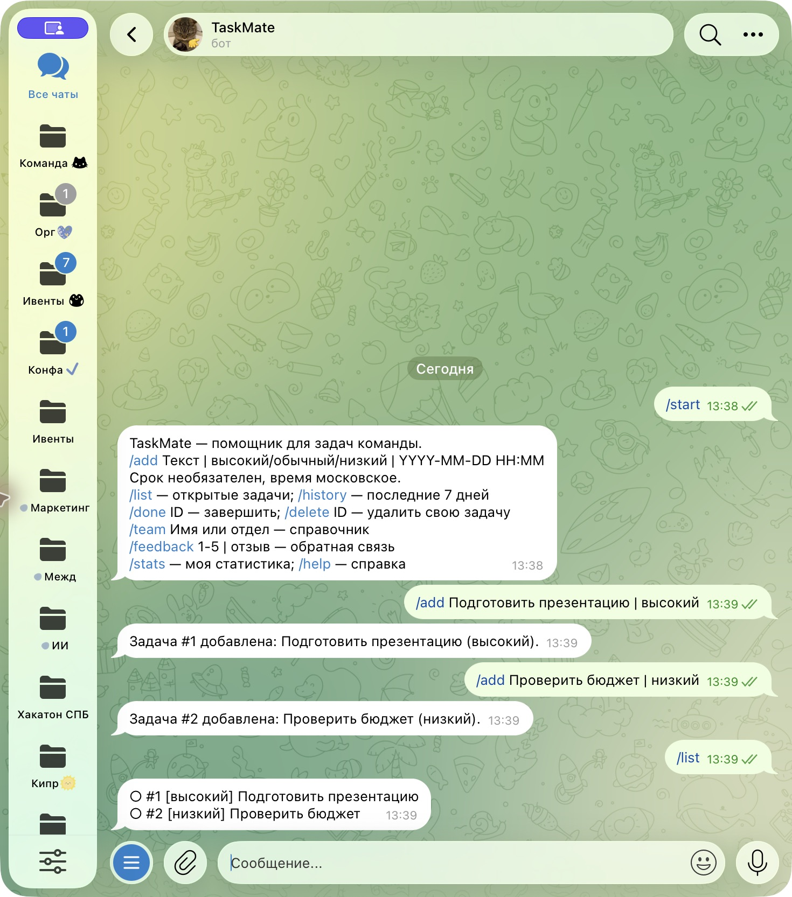
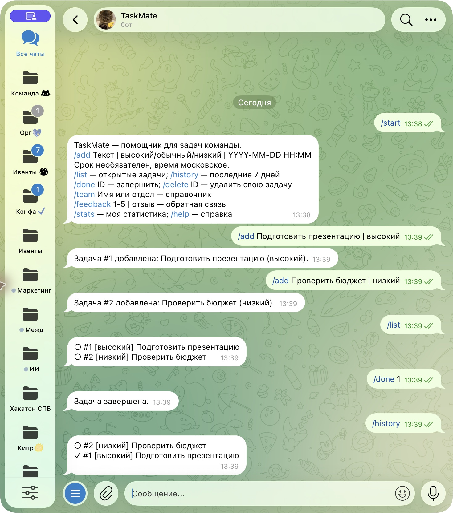

University: [ITMO University](https://itmo.ru/ru/)
Faculty: [FICT](https://fict.itmo.ru)
Course: [Vibe Coding: AI-боты для бизнеса](https://github.com/ex-itmo-ict-faculty/vibe-coding-for-business)
Year: 2026
Group: U4225
Author: Степанов Даниил Сергеевич
Lab: Lab1
Date of create: 13.10.2026
Date of finished: не защищена

# Создание первого Telegram-бота без программирования

## Цель и описание задачи
Создать помощника для личных задач участников команды с помощью LLM.
Задачи в переписке теряются, приоритеты не видны, сроки забываются.
TaskMate сохраняет задачи и предоставляет короткие команды в привычном Telegram.
Выбрана задача с проверяемым результатом и возможностью расширить источники данных.

## Промпт-инжиниринг
[Исходный и финальный промпты](prompt.md). Код создан в диалоге с Codex.
Итерации: выделение бизнес-логики для автономной проверки, защита задач от
доступа другого пользователя, валидация сроков и ограничение длины ответов.
Промпты фиксируют постановку и уточнения; это не дословная выгрузка диалога.

## Стек и реализация
Python, python-telegram-bot 22.5 для асинхронного Telegram API и JobQueue,
python-dotenv 1.2.1 для локальных настроек. SQLite входит в стандартную библиотеку.
`bot.py` принимает сообщения, `service.py` обрабатывает команды и хранит данные.
Внешняя LLM во время работы не вызывается. Команды: /start, /help, /add,
/list, /done, /delete, /history, /team, /feedback, /stats.
Напоминания проверяются каждые 30 секунд и сохраняют состояние в SQLite.

## Запуск и тестирование
[Инструкция запуска](../README.md#запуск).
Десять автоматических проверок прошли: жизненный цикл и сохранение, изоляция,
валидация и сортировка, CSV, отзывы, напоминания, SQL-строка в тексте задачи.
Дополнительно проверены Telegram-обработчик в приватном чате, отказ в группе,
отправка напоминания через тестовый транспорт и повтор после сетевого сбоя.
[Результат выполнения](../docs/evidence/tests.txt).
[Автономные команды и ответы](../docs/evidence/demo.txt).

## Скриншоты и видео

Проверка выполнена 13.10.2026 в настоящем Telegram-чате с
[@itmoftmi_dss_bot](https://t.me/itmoftmi_dss_bot), при локальном запуске бота.

### Приветствие и справка

### Добавление задач и приоритеты

/list показал задачу с высоким приоритетом перед задачей с низким.

### Завершение и история

После /done 1 задача отмечена галочкой в истории.

[Протокол автономных проверок](../docs/evidence/tests.txt) дополняет
проверку Telegram. [Сценарий видео 2–3 минуты](../docs/evidence/video-script.md);
само видео и ссылка пока отсутствуют.

## Трудности и решения
Для проверки без токена логика отделена от Telegram. HTTP-логирование снижено,
чтобы сетевые URL с токеном не попадали в журнал. Для длинного списка ответы
разбиваются на сообщения. Личные задачи разрешены только в приватных чатах.

## Выводы
Создана проверенная локально логика бота с понятными командами и сохранением.
Освоены постановка требований LLM, проверка результата и безопасная конфигурация.
Можно улучшить интерфейс кнопками и пагинацией. Основные команды проверены в Telegram. Запись видео
и защита ещё не выполнены; лабораторная пока не готова к окончательной сдаче.

## Фактическое подключение Telegram — 13.10.2026

Бот зарегистрирован пользователем в BotFather: [@itmoftmi_dss_bot](https://t.me/itmoftmi_dss_bot).
Токен сохранён в локальном .env и исключён из Git. Запрос getMe успешно
подтвердил username. Приложение запущено в режиме long polling, журнал
подтверждает Application started. Это подтверждает подключение API;
Основные команды дополнительно проверены в реальном чате: скриншоты приведены выше.
Облачный деплой ещё не выполнен.

## Доставка напоминания в Telegram

Задача №3 создана в 13:40 со сроком 13.10.2026 13:42 МСК.
В 13:42 бот прислал напоминание о наступлении срока.
