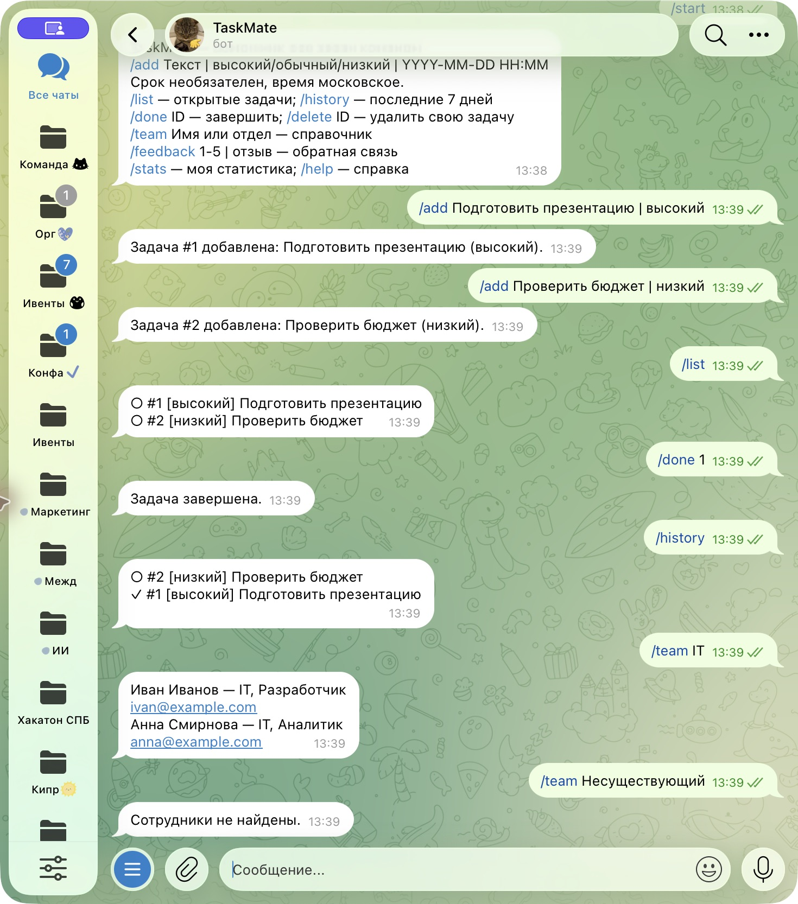

University: [ITMO University](https://itmo.ru/ru/)
Faculty: [FICT](https://fict.itmo.ru)
Course: [Vibe Coding: AI-боты для бизнеса](https://github.com/ex-itmo-ict-faculty/vibe-coding-for-business)
Year: 2026
Group: U4225
Author: Степанов Даниил Сергеевич
Lab: Lab2
Date of create: 13.10.2026
Date of finished: не защищена

# Подключение бота к данным

## Цель и описание интеграции
Добавить сохранение задач, историю, поиск сотрудников и сбор оценок.
Выбраны SQLite и CSV: они не требуют платного API и позволяют воспроизводимые проверки.
CSV содержит учебные вымышленные данные: name, department, role, email.
[Исходный справочник](../data/employees.csv).
SQLite: tasks(id,user_id,chat_id,text,priority,due,done,reminded,created),
feedback(id,user_id,rating,text,created). Сроки хранятся в UTC, ввод и вывод — МСК.

## Промпт
[Исходный промпт, уточнения и финальная постановка](prompt.md).
Существующие команды сохранены. Добавлены /team, /history, /feedback, /stats.

## Реализация
Стандартные библиотеки csv, sqlite3, datetime, zoneinfo; дополнительные
зависимости для источников данных не понадобились.
Каждый запрос к задачам содержит user_id. SQL параметризован:

```python
con.execute('SELECT * FROM tasks WHERE user_id=?', (user,))
```

CSV читается в UTF-8 с поддержкой BOM; проверяются обязательные столбцы.
Поиск регистронезависимый по имени и отделу. Отсутствие файла или результатов
даёт понятное сообщение. История ограничена последними семью днями.
[Полная реализация](../service.py).

## Тестирование
/team IT → Иван Иванов и Анна Смирнова с учебными контактами.
/team Несуществующий → «Сотрудники не найдены».
/feedback 4 | Тестовая запись: удобно → «Спасибо! Отзыв сохранён».
Некорректная оценка отклоняется. Пересоздание Service подтверждает сохранение
задач в БД; другой user_id не видит и не изменяет чужие задачи.
[Протокол](../docs/evidence/tests.txt), [демо](../docs/evidence/demo.txt).

## Скриншоты и видео

Проверка выполнена 13.10.2026 в настоящем чате Telegram.

### Поиск сотрудников и отсутствие результата

Бот вернул Ивана Иванова и Анну Смирнову из учебного CSV. Для неизвестного
запроса ответил «Сотрудники не найдены».

### Сохранённая история задач

История содержит открытые и завершённые задачи.

### Валидация, обратная связь и статистика

Неверный приоритет отклонён; технический отзыв сохранён; статистика показала
две задачи и одну завершённую. Это проверка функций, а не пользовательский опрос.

[Сценарий видео](../docs/evidence/video-script.md); видео и ссылка пока отсутствуют.

## Трудности и решения
SQL-строка в тексте безопасно сохраняется как данные благодаря параметрам.
Сроки нормализованы в UTC. Отсутствующий CSV обрабатывается без остановки бота.
SQLite хранится вне Git, чтобы не публиковать пользовательские данные.

## Выводы
Реализованы две интеграции, корректное форматирование и обработка ошибок.
Освоены структура таблиц, фильтрация, валидация и тестирование сохранения.
Можно добавить CSV-импорт из административного интерфейса. Видео ещё нужно для завершения лабораторной.

## Фактическое подключение Telegram — 13.10.2026

Бот зарегистрирован пользователем в BotFather: [@itmoftmi_dss_bot](https://t.me/itmoftmi_dss_bot).
Токен сохранён в локальном .env и исключён из Git. Запрос getMe успешно
подтвердил username. Приложение запущено в режиме long polling, журнал
подтверждает Application started. Это подтверждает подключение API;
Основные команды дополнительно проверены в реальном чате: скриншоты приведены выше.
Облачный деплой ещё не выполнен.
