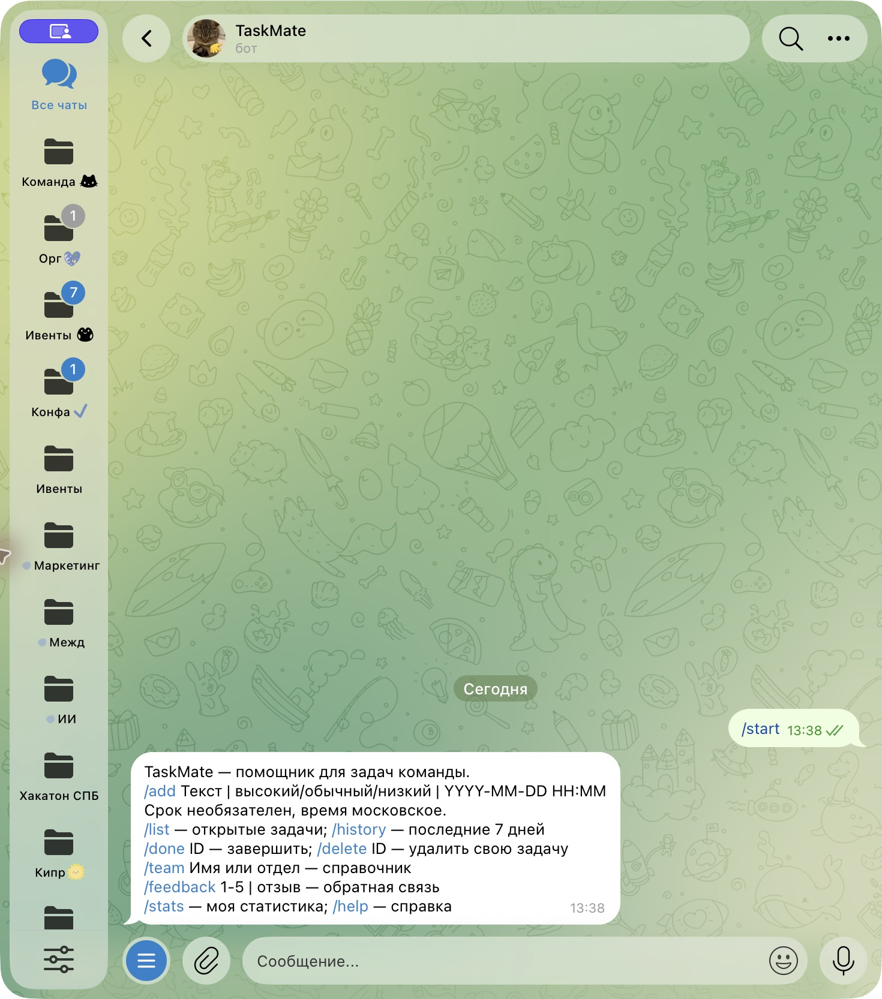
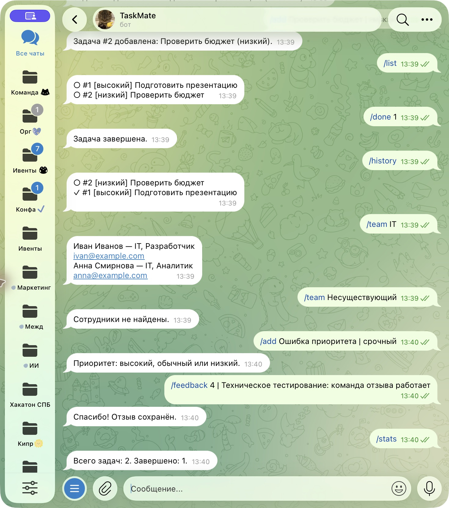
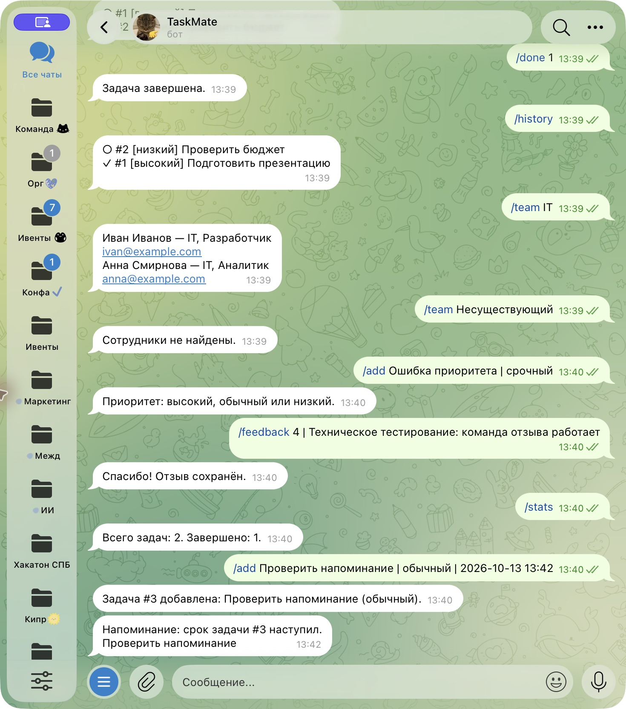

University: [ITMO University](https://itmo.ru/ru/)
Faculty: [FICT](https://fict.itmo.ru)
Course: [Vibe Coding: AI-боты для бизнеса](https://github.com/ex-itmo-ict-faculty/vibe-coding-for-business)
Year: 2026
Group: U4225
Author: Степанов Даниил Сергеевич
Lab: Lab3
Date of create: 13.10.2026
Date of finished: не защищена

# Деплой и сбор обратной связи

## Цель и выбранный способ
Подготовить круглосуточный Telegram worker и исследовать опыт пользователей.
Выбран Docker + VPS: постоянный процесс, автоматический перезапуск и volume
для SQLite. Используется long polling, поэтому webhook и ngrok не нужны.
Бот зарегистрирован: [@itmoftmi_dss_bot](https://t.me/itmoftmi_dss_bot).
Проверка Telegram выполнена при локальном запуске; VPS ещё не настроен.

## Процесс деплоя
Подготовлены Dockerfile, compose.yaml, .dockerignore, .env.example и CI.
[Пошаговая инструкция](deployment.md). Токен поступает через окружение,
контейнер работает от непривилегированного пользователя, БД хранится в volume.
Требуется VPS с Docker и токен. Контейнер не был собран и запущен на VPS;
работа 24/7, перезапуск и стабильность несколько часов пока не подтверждены.

## Проверки и скриншоты

Десять автономных проверок прошли. Этот скриншот не является доказательством
облачного деплоя. После запуска нужно приложить docker compose ps, журнал
без секретов, Telegram-диалог и измерения памяти за несколько часов.
[Протокол](../docs/evidence/tests.txt).

## Проверка доступности в Telegram

13.10.2026 бот реально ответил на команды в локальном запуске.

На скриншоте /feedback виден отзыв «Техническое тестирование: команда отзыва
работает». Он добавлен для проверки сохранения и не учитывается как отзыв
независимого участника. Эти скриншоты подтверждают доступность локального бота,
а не облачный деплой, стабильность 24/7 или завершение пользовательского опроса.

## Сбор обратной связи и статистика
Реальных пользователей: 0. Реальных отзывов: 0. Данные об использовании
не собраны. Тестовый отзыв в демо исключён из пользовательской статистики.
[План тестирования минимум с тремя участниками](feedback-plan.md).
/feedback сохраняет оценки 1–5 и текст. /stats показывает личные задачи.
Скриншоты настоящих отзывов пока отсутствуют.

## Анализ и улучшения
Анализ удовлетворённости невозможен до получения отзывов. Приоритеты будут
определены по частоте и влиянию проблемы. В текущей версии добавлены валидация,
изоляция пользователей и устойчивое состояние напоминаний по техническим
проверкам. Эти изменения не выдаются за улучшения по реальному фидбеку.
Повторные отзывы пока отсутствуют. [Промпт следующей итерации](prompt.md).

## Трудности и решения
Без токена и доступа к VPS нельзя подтвердить доступность бота. Подготовлена
воспроизводимая инструкция. Volume предотвращает потерю БД при пересборке.
Webhook исключён из инструкции, поскольку приложение использует polling.

## Выводы и статус
Освоена подготовка worker к контейнеризации, управление секретами и план
сбора обратной связи. Деплой, длительное наблюдение, отзывы 3+ пользователей,
улучшения по ним и повторная проверка остаются невыполненными. Лабораторная
не завершена. Следующий шаг — подключить Telegram и VPS, затем провести
пользовательский эксперимент. Дата защиты будет указана после защиты.

## Фактическое подключение Telegram — 13.10.2026

Бот зарегистрирован пользователем в BotFather: [@itmoftmi_dss_bot](https://t.me/itmoftmi_dss_bot).
Токен сохранён в локальном .env и исключён из Git. Запрос getMe успешно
подтвердил username. Приложение запущено в режиме long polling, журнал
подтверждает Application started. Это подтверждает подключение API;
Основные команды дополнительно проверены в реальном чате: скриншоты приведены выше.
Облачный деплой ещё не выполнен.

## Доставка напоминания в Telegram

Задача №3 создана в 13:40 со сроком 13.10.2026 13:42 МСК.
В 13:42 бот прислал напоминание о наступлении срока.

## Фоновый локальный запуск на macOS

Для проверки бот запущен как пользовательская служба LaunchAgent
`edu.itmo.taskmate` с автоматическим перезапуском. Рабочая копия находится в
`~/Library/Application Support/TaskMate`, база — `data/bot.db` внутри этой папки.
Токен хранится в закрытом локальном .env, в plist его нет. `launchctl print`
подтвердил состояние running, журнал — Application started. Это локальный
запуск на компьютере пользователя; облачный VPS и работа 24/7 не подтверждены.

Остановка: `launchctl bootout gui/$(id -u)/edu.itmo.taskmate`.
Повторный запуск: `launchctl bootstrap gui/$(id -u) ~/Library/LaunchAgents/edu.itmo.taskmate.plist`.
Одновременно запускать вторую копию с тем же токеном нельзя: Telegram вернёт Conflict.
